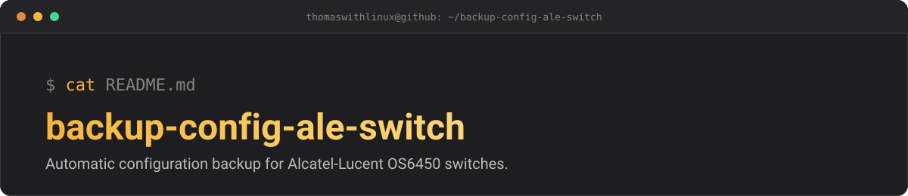

<p align="center">
  
</p>

# backup-config-ale-switch — *back up every switch, automatically*


Python script that connects over **SSH with Netmiko** to **Alcatel-Lucent
Enterprise OS6450** switches (all models, whatever the number of ports) and
**automatically backs up their configuration** to a NAS.

## Table of contents

- [Features](#features)
- [Requirements](#requirements)
- [Installation](#installation)
- [Configuration](#configuration)
- [Usage](#usage)
- [Scheduling with cron](#scheduling-with-cron)
- [Roadmap](#roadmap)
- [Project structure](#project-structure)
- [License](#license)
- [Author](#author)

## Features

- SSH connection to ALE OS6450 switches using **Netmiko**
- Configuration retrieval with the `show configuration snapshot` command
- One backup folder per switch to keep everything tidy
- Backups stored on a **NAS over SMB**
- Retention policy: only the **5 most recent backups** per switch are kept,
  older ones are deleted automatically
- Logging and error handling: if a switch does not answer, the script carries
  on with the next ones

## Requirements

- Linux (tested on **Ubuntu**)
- **Python 3.8+**
- SSH access enabled on the switches
- An accessible SMB share (NAS)

## Installation

```bash
# Clone the repository
git clone https://github.com/thomaswithlinux/backup-config-ale-switch.git
cd backup-config-ale-switch

# Install the dependencies
pip install -r requirements.txt
```

## Configuration

1. **Mount the NAS SMB share** on the Linux machine:

```bash
sudo apt install cifs-utils
sudo mkdir -p /mnt/backups
sudo mount -t cifs //NAS_IP/backups /mnt/backups -o username=USER
```

2. **Fill in the list of switches** in the script (name, IP address,
   credentials):

```python
switches = [
    {"name": "SW-CORE", "host": "192.168.X.X"},
    {"name": "SW-01",   "host": "192.168.X.X"},
]
```

> **Important:** never publish your real credentials or real IP addresses on
> GitHub. Use environment variables or a configuration file added to
> `.gitignore`.

## Usage

```bash
python3 backup_switches.py
```

Example of the resulting tree:

```
/mnt/backups/
├── SW-CORE/
│   ├── SW-CORE_2026-09-28_02-00.txt
│   └── ...
└── SW-01/
    ├── SW-01_2026-09-28_02-00.txt
    └── ...
```

## Scheduling with cron

To run the backup every day at 2 a.m.:

```bash
crontab -e
```

```
0 2 * * * /usr/bin/python3 /path/to/backup_switches.py
```

## Roadmap

- [ ] Separate configuration file (YAML or `.env`)
- [ ] E-mail notification on failure
- [ ] Configuration comparison (change detection)

## Project structure

```
backup-config-ale-switch/
├── docs/
│   └── banner.svg            # README banner
├── backup-ale-os6450.py      # the backup script
├── requirements.txt          # Python dependencies
├── LICENSE                   # MIT license
└── README.md                 # this file
```

## License

Released under the **MIT** license — see the [LICENSE](LICENSE) file.

## Author

**Thomas Letard** — [@thomaswithlinux](https://github.com/thomaswithlinux) ·
[Portfolio](https://thomaswithlinux.github.io/)
Apprentice TSSR · Linux, networking & automation
